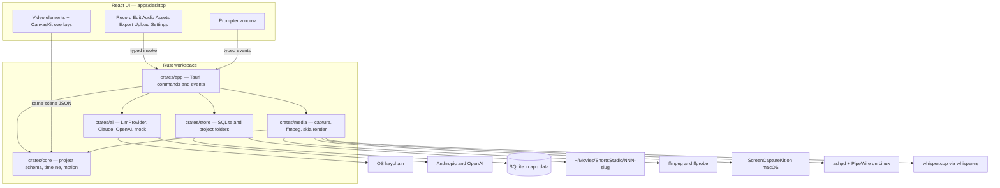
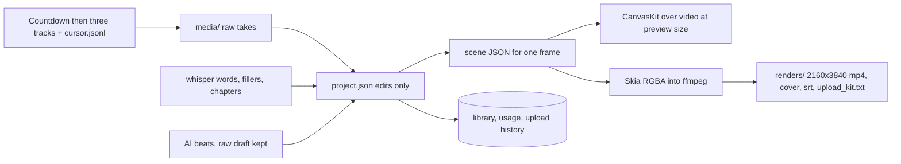

# Plan — Shorts Studio

Last updated: 2026-11-19 21:53 +0530

This is the working plan. The product contract is [`docs/PROMPT.md`](docs/PROMPT.md). Re-read that file at the start of every session, then read `progress.md`, and continue only the current module. When a module's full test gate passes, stop and wait for "continue".

No application code exists yet. This file is the review gate before M00.

## Overview

Shorts Studio is a local desktop app for one YouTube Short per day. The whole path stays on the machine: draft a script with Claude or ChatGPT, read it from a teleprompter that is absent from the recording, capture screen, camera, and microphone as three tracks, edit on a timeline, render a 2160×3840 file with captions, camera, cursor zoom, cover, and end card, and leave with a YouTube upload kit.

Primary machine: Mac Mini M4, 24 GB, macOS. Secondary: this Omarchy desktop (Arch, Hyprland, Wayland, PipeWire), where recording, editing, and export must work. Ubuntu and Windows stay unblocked and unbuilt.

The product name is Shorts Studio. The Cargo package, pnpm package, and binary are `shorts-studio`. The git directory stays `Youtube-Shorts-Making-System`. Projects live in `~/Movies/ShortsStudio/<NNN-slug>/`.

Work happens one module at a time, on a branch named in the module table below. Commits stay local until you ask to push.

## Architecture



`core` has no Tauri, no network, and no ffmpeg. `media`, `ai`, and `store` depend on `core`. `app` wires them to Tauri. The React app talks only through the generated command boundary.

## Crate and folder layout

```
.
├── Cargo.toml                 # Rust workspace
├── pnpm-workspace.yaml
├── package.json               # root scripts only
├── justfile
├── plan.md
├── progress.md
├── DECISIONS.md
├── docs/PROMPT.md
├── policy/youtube-shorts.json # data, loaded at runtime
├── prompts/                   # versioned script and upload-kit templates
├── apps/desktop/
│   ├── index.html
│   ├── vite.config.ts
│   ├── src/                   # React 19 screens, CSS modules, zustand
│   ├── src/bindings/          # ts-rs output, committed
│   └── src-tauri/             # thin Tauri binary, calls crates/app
├── crates/
│   ├── core/                  # schema, timeline maths, motion sampling
│   ├── media/                 # ffmpeg child processes, capture, skia
│   ├── ai/                    # LlmProvider
│   ├── store/                 # rusqlite, atomic project writes
│   └── app/                   # Tauri commands, no webview in unit tests
├── packages/motion/           # TS port of core motion, locked by shared vectors
├── scripts/fixtures.sh
├── scripts/hooks/pre-commit
├── tests/e2e/                 # Playwright, Tauri IPC mocked
├── tests/fixtures/            # gitignored, regenerated
└── tests/golden/              # small committed frames and hashes
```

`apps/desktop/src-tauri` is the Tauri entry the CLI expects. Command implementations live in `crates/app` so they can be tested without a webview.

## Data flow



Raw takes are immutable. Autosave writes `project.json.tmp` and renames it over `project.json`. A shared monotonic clock stamps each track; the measured offset is stored on the take. Preview and export both sample the motion library at 60 fps from the same scene description.

## Decisions already made

These are recorded in [`DECISIONS.md`](DECISIONS.md). Versions are pinned when the dependency is added, after reading that version's docs.

| Topic | Choice |
|---|---|
| Shared types | `ts-rs` on the Rust schema. Generated `.ts` files are committed. `zod` validates runtime JSON. |
| Styling | CSS modules and the §3 tokens as CSS variables. Fonts vendored. |
| SQLite | `rusqlite` with bundled SQLite. |
| Linux capture | `ashpd` ScreenCast plus the `pipewire` crate. GStreamer `pipewiresrc` is the fallback if frame negotiation fails in M06. |
| macOS capture | `screencapturekit`, using `with_excluding_windows`. A Swift sidecar only if that call cannot see the prompter window id. |
| Motion | Rust implementation in `core`. A TS port in `packages/motion`. One shared vector file must match on both sides. |
| OpenAI HTTP API | Chosen in M03 after reading the current docs. Preference is the Responses API when it streams and accepts a JSON schema. |
| Preview drawing | CanvasKit on the shared scene JSON. If the wasm cost misses the preview budget, keep the scene JSON and record the visual gap. |
| Whisper default | Configurable. Initial default model file `ggml-large-v3-turbo`, multilingual, Metal on macOS. |
| Spend cap | USD 20 per month, alert at 80%, both settings. |
| Duration estimate | 140 words per minute for Hinglish, a setting. |
| YouTube upload | Off until you turn it on. Copy-out kit is the daily path. |
| Background removal | Try a simple portrait model in M09. Skip and record why if it threatens that module. |

## Tooling

- `just dev` — Tauri dev with Vite hot reload.
- `just doctor` — ffmpeg/ffprobe versions, hardware encoders, whisper model presence, macOS permission state, Linux portal and PipeWire.
- `just lint` — ESLint, Prettier, `cargo fmt --check`, `cargo clippy -- -D warnings`, `tsc --noEmit`.
- `just test-module MXX` — that module's tests.
- `just test` — lint, Rust tests, Vitest, Playwright, media goldens.
- `just build` — local release build, no signing.

The pre-commit hook is `scripts/hooks/pre-commit`. `just setup` copies it into `.git/hooks/`. It runs lint and the fast unit tests. It does not change git config.

`just doctor` and `just test` must pass on Omarchy for modules that are not macOS-only. macOS permission and ScreenCaptureKit checks are implemented behind `cfg` and listed as MANUAL until they are run on the Mini. `just doctor` on the Mini is the M00 manual check named in the prompt.

## Modules

Branch names are fixed. A module is ✅ only after the §7 gate: `just lint`, `just test-module`, `just test`, and media goldens when the module touches media.

### M00 — Repo scaffold and tooling — `m00-scaffold`

**Goal.** An empty Tauri window boots, and one command runs the whole gate.

**Deliverables.** pnpm + Rust workspace, the five crates as compileable shells, `justfile`, ESLint, Prettier, rustfmt, clippy as errors, strict TypeScript, `scripts/fixtures.sh`, Playwright smoke, pre-commit hook.

**Automated tests.** Playwright loads the dev server and sees the window shell with Tauri IPC mocked. `just doctor` exits 0 on this Linux machine when ffmpeg and the portal/PipeWire checks pass. `just test` is green.

**Manual.** On the Mac Mini, `just doctor` reports ffmpeg, VideoToolbox encoders, and screen/camera/mic permission state.

### M01 — Project model and storage — `m01-project-model`

**Goal.** One schema, crash-safe on disk, queryable in SQLite.

**Deliverables.** `project.json` v1: tracks, clips, keyframes, captions, layout, audio chain, assets, export settings, AI metadata, take sync offsets. Migration hook. Library tables: projects, topics, ai_usage, uploads, originality hashes. New, open, save, autosave every 5 s via temp file plus rename. `ts-rs` output checked in.

**Automated tests.** Rust ⇄ TS round-trip of a fixture project. `proptest` clip ordering (no overlaps, stable sort). Kill during autosave and recover the last complete file. Migrate a v0 fixture through the hook.

**Manual.** None.

### M02 — UI shell and design system — `m02-ui-shell`

**Goal.** All seven screens exist, static, on the §3 theme.

**Deliverables.** Tokens, vendored Space Grotesk and JetBrains Mono, buttons, pills, toggles, cards, inputs, top bar (`>>`, `sudoakshay/shorts`, project name, six step tabs, AI settings, context action), routes, accent switcher. Placeholder data only.

**Automated tests.** Vitest + Testing Library for each primitive. Playwright visits all seven screens. axe reports no serious or critical violations. Visual snapshot of each screen at 1440×900.

**Manual.** Glance at the shell on the Mini once a build exists there. Not a gate for this module if Linux snapshots pass.

### M03 — AI providers — `m03-ai-providers`

**Goal.** One trait, two providers, keys in the keychain, spend enforced.

**Deliverables.** `LlmProvider`. Anthropic Messages streaming. OpenAI streaming (endpoint confirmed against current docs in this module). Model list from each provider's models endpoint. Keychain via `keyring`. Test button. Per-call token rows in SQLite. Monthly cap and 80% alert. Mock provider with fixtures. Routing table: script, upload kit, cover text, fact-check.

**Automated tests.** Mock streaming and JSON parse. One retry when schema validation fails, with the error included. Log redaction of key-shaped strings. Cap blocks a call at 100% and alerts at 80%. Live tests compile and skip unless `LIVE_AI=1`.

**Manual.** Paste a real key, press Test, confirm the key is absent from `project.json` and from logs.

### M04 — Script generator — `m04-script-generator`

**Goal.** A Hinglish Short becomes editable beats, and the raw draft is kept.

**Deliverables.** Versioned `prompts/*.md`. Beats HOOK / CONCEPT / DEMO / FIX / CTA with timestamps, hook inside 3 s, `[CUE]` lines, CTA, optional fact-check notes. Editable beat list. Word count and duration at the configured words per minute. Regenerate one beat. Store the raw draft for the originality check.

**Automated tests.** Fixture model output validates against the beat schema. Duration estimator cases. An edit survives save and reload.

**Manual.** Generate one real script with `LIVE_AI=1` and read it. Not required for ✅.

### M05 — Teleprompter window — `m05-prompter`

**Goal.** A prompter you can read, which the recording cannot see.

**Deliverables.** Always-on-top transparent window. Scroll from `requestAnimationFrame` using elapsed time. Speed, text size, mirror, opacity, "under webcam", distinct `[CUE]` style. Hotkeys: Space, ↑↓, ⌘⇧P. Countdown starts the scroll. Voice-follow: 2–3 s mic chunks, whisper, fuzzy match, pause on silence, fall back to fixed speed when confidence is low. macOS: `SCContentFilter` excludes the prompter window id, plus sharing type none as a second line. Linux: allow a different monitor, or a window/region that does not overlap; otherwise refuse with a reason.

**Automated tests.** Time → scroll offset. Fuzzy matcher on Hinglish fixtures. Linux overlap geometry, including the refusal cases. Magenta exclusion test: 3 s capture, histogram has no magenta frames. On Linux the magenta capture is skipped and listed MANUAL, because the portal cannot exclude one window. On macOS it runs when screen-recording permission is granted, otherwise skip plus MANUAL.

**Manual.** On Omarchy: prompter visible, click-through on the text, controls still clickable, refusal message when it overlaps a monitor capture. On the Mini: record 3 s and confirm the prompter is absent.

### M06 — Recording engine — `m06-recording`

**Goal.** Three files and a cursor log, one clock.

**Deliverables.** Display, window, and region sources. Camera and mic device lists and a live mic meter. Click highlights and keystrokes as overlay data. macOS best-effort hide of desktop icons. `screen.mov` (hardware encoder, high bitrate), `cam.mov`, `mic.wav` at 48 kHz, `cursor.jsonl` at about 120 Hz. Shared start clock, 3 s countdown, pause/resume, disk-space estimate. Presets: screen + cam bottom-right, cam only, screen only. Linux cursor mode `metadata` when the portal advertises it; `cursor.jsonl` is still recorded by the app, because the editor needs clicks and a steady rate.

**Automated tests.** lavfi sources stand in for devices. All three outputs exist. ffprobe durations agree within 50 ms. Cursor log parses and is monotonic.

**Manual.** One real take on the Mini and one on Omarchy. Confirm sync by eye and by the stored offset.

### M07 — Transcription and analysis — `m07-transcription`

**Goal.** Words with times, fillers, silences, chapters.

**Deliverables.** Background `whisper-rs` after each take. Word timestamps. Configurable filler list (`umm`, `uh`, `matlab`, `basically`, `you know`, …). Silences longer than 0.6 s. Chapters by matching script beats to the transcript.

**Automated tests.** Fixture speech: expected words within ±150 ms. Filler and silence detection on synthetic audio. Chapter match on a fixture transcript.

**Manual.** A one-minute Hinglish take on the Mini (Metal) and a note in `progress.md` on accuracy. Linux uses the CPU or Vulkan path available on this machine; record which.

### M08 — Timeline editor — `m08-timeline`

**Goal.** Non-destructive cuts with undo.

**Deliverables.** Tracks V3 FX, V2 CAM, V1 SCREEN, TXT, A1 VOICE, A2 MUSIC, A3 SFX. In/out, split, trim, ripple delete, move, snap, speed 0.25–4×, markers, zoom keyframes, transitions (cut, fade, wipe, glitch). Multi-select. Command-pattern undo/redo, 100 steps, Immer for the timeline draft. Shortcuts from §3. Scrub. Waveform from cached peaks. 720p proxies.

**Automated tests.** `proptest`: split, trim, and ripple keep clips disjoint and duration consistent. Undo/redo returns the same project. Playwright: split, ripple delete, undo.

**Manual.** Scrub a real take and confirm the playhead stays in sync with the preview.

### M09 — Layout, cam, and captions — `m09-layout-captions`

**Goal.** The 9:16 frame, the camera chip, and word-by-word captions match the safe zone.

**Deliverables.** Cursor-following crop with a critically damped spring, plus manual zoom keyframes. Camera on a 3×3 grid, sizes S/M/L, shapes circle / rounded / square, accent border. Safe-zone guides and snapping. Captions: active word in the accent colour, max two lines, editable, Hinglish. Background removal only if the spike in this module stays small.

**Automated tests.** Crop rect stays inside the source and moves at most N px per frame on a fixture cursor path. Safe-zone snap cases. Caption line breaking, including a long Hinglish line. Golden frames for the three camera shapes.

**Manual.** Toggle safe zone on a real frame and confirm the camera and captions sit inside the guides.

### M10 — Audio processing — `m10-audio`

**Goal.** A voice that lands at −14 LUFS, with music moving out of its way.

**Deliverables.** Voice chain with bypass and amount: noise (`arnndn`, or `afftdn` if the build lacks the model), EQ / highpass, compressor, de-esser. Sidechain ducking, attack 80 ms, release 400 ms, −12 dB default. Per-track gain, mute, solo. A/B preview. Striking a transcript word cuts picture and sound together, with 20 ms crossfades. Two-pass `loudnorm` I=-14, TP=-1.0 on the final mix.

**Automated tests.** Fixture mix within ±0.5 LU of −14. True peak ≤ −1.0 dBTP via `ebur128`. Music level drops by about the duck amount while voice is present. Cut points stay under the click threshold.

**Manual.** Bypass each voice stage on a real take and confirm the A/B difference.

### M11 — Render engine — `m11-render`

**Goal.** The same scene becomes a deterministic 4K file.

**Deliverables.** Decode with ffmpeg, composite with `skia-safe`, pipe RGBA to ffmpeg. 2160×3840, 1440p, 1080p. 30 or 60 fps. H.264 or HEVC via the encoder `doctor` found, else `libx264` / `libx265`. AAC 48 kHz 384 kbps. `+faststart`. Easing presets, overlays sampled at 60 fps, motion blur at 4–8 samples, smoothed cursor, frame blend on speed-ups. Queue with progress, ETA, cancel, output folder.

**Automated tests.** ffprobe: resolution, fps, codec, duration ±1 frame, audio rate. Golden-frame SSIM ≥ 0.98 against the fixture. Preview-resolution render vs downscaled export SSIM ≥ 0.95. Repeat render, same frame hashes. A moving square shows a blurred edge when blur is on. Log the wall time. Budget: 60 s at 4K30 in under 3 min on the M4. Record the Omarchy number too.

**Manual.** Watch the exported fixture on the Mini for dropped motion and a late moov atom (file starts playing immediately).

### M12 — Auto assets — `m12-auto-assets`

**Goal.** Three covers and a 3 s end card from data you already have.

**Deliverables.** Templates A hook + face, B error hook, C before/after. Face frame heuristic: largest face, open expression. Key code line. 1080×1920 PNG. Optional burn-in of the first 0.5 s. End card: chevron, Next card, Follow pill double-pulse, `BUILD. LEARN. REPEAT.` Styles: Rise, Glitch, Slide, Terminal type. Next title from the topic queue. "Add to every new Short".

**Automated tests.** PNG dimensions and file size bounds. Long and short hooks stay inside the frame. End-card frames at 0.0, 0.6, 1.3, and 2.0 s match goldens.

**Manual.** Read the three covers at phone size and pick a default template.

### M13 — Export screen and pre-flight — `m13-export`

**Goal.** The export screen tells you the truth before a long render.

**Deliverables.** §3 export UI wired to M11. Checks: 9:16, length ≤ policy max, loudness, captions and camera inside the safe zone, music-licence tick, originality warnings (trigram on topic and title against the last 10, script edit distance vs the raw draft, warn under 20% changed, layout/template repeat). Warnings inform. They do not block.

**Automated tests.** Each rule, one good and one bad fixture project. Originality warnings fire on a near-copy and stay quiet on a distinct fixture.

**Manual.** Run pre-flight on a real project and confirm the warning copy.

### M14 — Upload kit — `m14-upload-kit`

**Goal.** Everything YouTube Studio asks for, as text you can paste.

**Deliverables.** Title with the keyword first and a live length. Description: hook, long-video link, 2–3 hashtags including `#Shorts`, never `#viral` or `#fyp`. Tags. Pinned-comment question. Every Studio field in the policy pack, each with copy, plus Copy all. `renders/upload_kit.txt`. Open Studio in the default browser. Policy pack shows `checked_on`. Optional YouTube Data API upload behind a toggle, loopback OAuth, `videos.insert`, `thumbnails.set`, captions, with a clear notice that an unverified Google project stays private. History in SQLite for originality and the 24–48 h reminder.

**Automated tests.** Kit schema. Banned hashtags stripped. Policy pack loads and the date is the one in the file. OAuth and insert calls against mocks.

**Manual.** Paste a kit into Studio once. Direct upload stays off until you create an OAuth client.

### M15 — Daily Short mode and polish — `m15-daily-mode`

**Goal.** Start today's Short, and the app pauses only where you must act.

**Deliverables.** Pipeline: topic → script → you review → record with prompter → auto-edit (fillers, silences, captions, cursor zoom, ducking) → cover and end card → 4K export → upload kit. Steps labelled AI / YOU / AUTO. Startup under 2 s. Timeline holds 60 fps with 10 clips. Errors for missing ffmpeg, denied permission, and a full disk. First-run: permissions, whisper download, API keys.

**Automated tests.** Fixture media plus the mock provider produce a 4K MP4, cover PNG, SRT, and upload kit. Duration is logged.

**Manual.** One real Short on the Mini, timed. Definition of done: under 15 minutes of your time for a 60 s Short, prompter absent, −14 LUFS, 2160×3840.

## Risks and mitigations

**Prompter exclusion on Wayland.** xdg-desktop-portal ScreenCast cannot drop a single window from a monitor stream. M05 refuses to record unless the prompter is on another monitor or the capture is a window/region that does not overlap it. The overlap test is pure geometry and runs in CI. The magenta proof is MANUAL on Linux and automatic on the Mini when permission exists. Click-through on Hyprland may differ from macOS `ignoresMouseEvents`; M05 has a manual check, and the text region is separate from the control buttons so a failed click-through still leaves a usable prompter.

**Finding the prompter window id on macOS.** `screencapturekit` 1.5.x exposes `SCContentFilter::create().with_display().with_excluding_windows()`. The remaining risk is mapping the Tauri window to an `SCWindow`. M05 does that match by owner pid and title, then excludes that id. Sharing type none is a second safeguard, not the proof. If the crate cannot see the window, a small Swift sidecar is the recorded fallback.

**A/V sync.** Three processes start at slightly different times. The app stamps one monotonic instant, each writer records its first-sample offset, and `project.json` stores the three offsets. The lavfi test requires durations within 50 ms. A clap detector (first audio spike) is the manual re-sync tool when a device starts late.

**4K render time.** 2160×3840 at 30 fps is a lot of RGBA. Decode and encode stay in ffmpeg. Skia only composites. Proxies are 720p for the timeline. The M11 test logs wall time. The budget is under 3 minutes for 60 s of 4K30 on the M4. Omarchy uses VAAPI or NVENC when `doctor` sees them, else `libx264`, and that number is recorded rather than treated as the Mac budget. Motion blur is off by default if it breaks the budget; the toggle stays.

**Whisper on Hinglish.** The default file is multilingual `ggml-large-v3-turbo`, with token timestamps (`whisper-rs` 0.16 exposes `set_token_timestamps` and experimental `set_split_on_word`). Voice-follow falls back to fixed speed when the fuzzy match is weak, so a bad transcript never sticks the scroll. Word-level tests use a synthetic English fixture with known times. A real Hinglish take is MANUAL in M07. If turbo is too slow on this desktop, the setting can point at a smaller multilingual model without a code change.

**`skia-safe` on Arch.** The crate is large to build and needs a C++ toolchain. `just doctor` will report whether the native deps are present before M11. If the build fails, the reason goes in `DECISIONS.md` before any renderer substitution.

**PipeWire video formats.** Portal streams are often DMA-BUF. The `pipewire` crate path has to negotiate a format ffmpeg can write. If that stalls in M06, switch to GStreamer `pipewiresrc` writing the file directly, and record it. Cursor clicks still come from our 120 Hz sampler; portal metadata mode is requested so the hardware cursor can stay out of the picture.

**CanvasKit weight.** Preview overlays prefer CanvasKit so they share Skia's look. The scene JSON is the real contract. If wasm init or preview fps is unacceptable, M11 records the fallback and the SSIM bar still applies to the Rust renderer.

**Tauri on Hyprland.** The webview is WebKitGTK. Transparent always-on-top windows are the fragile part. M05 is where we learn that, on this machine, before any Mac-only work depends on it.

**Secrets.** Keys go to the OS keychain through `keyring` (macOS Keychain, Linux Secret Service). Logs run a redaction pass. Tests feed fake keys and assert they never appear. No telemetry sinks are added.

## Open questions

1. **Monitors on the Omarchy desk.** Full-monitor capture on Wayland is only safe when the prompter sits on a different display. If this machine has one screen, daily Linux recording will be window or region capture. Which is your setup?
2. **Mac checks.** This workspace is the Omarchy machine. I will implement macOS capture and the magenta test behind `cfg`, and mark them MANUAL until you run them on the Mini. Say if you want a different split.
3. **Monthly cap.** Default is USD 20, alert at 80%. Say if you want another number before M03.
4. **First commit.** These planning files are uncommitted so you can edit them first. Say if you want them on `main` before M00 starts.

## Session rule

After you approve this plan, the next session starts M00 on branch `m00-scaffold` and stops when the M00 gate passes. It does not start M01.
